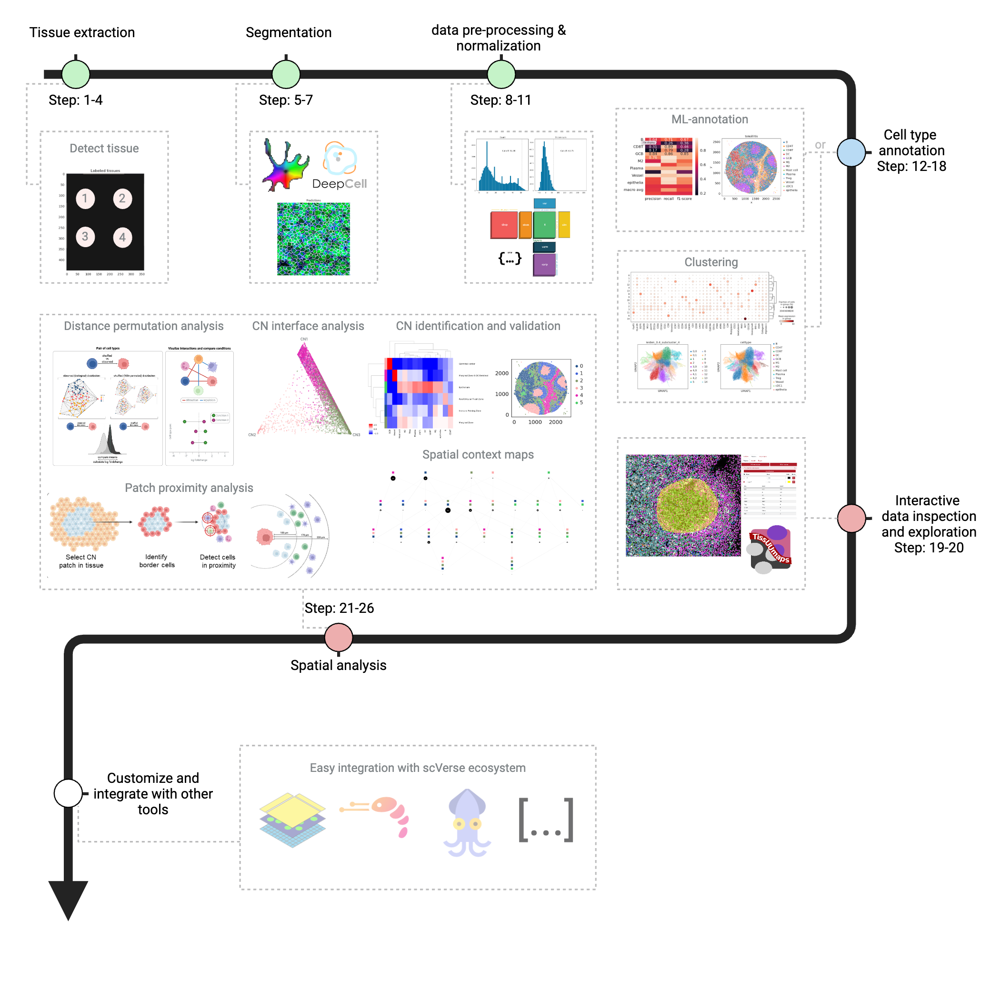
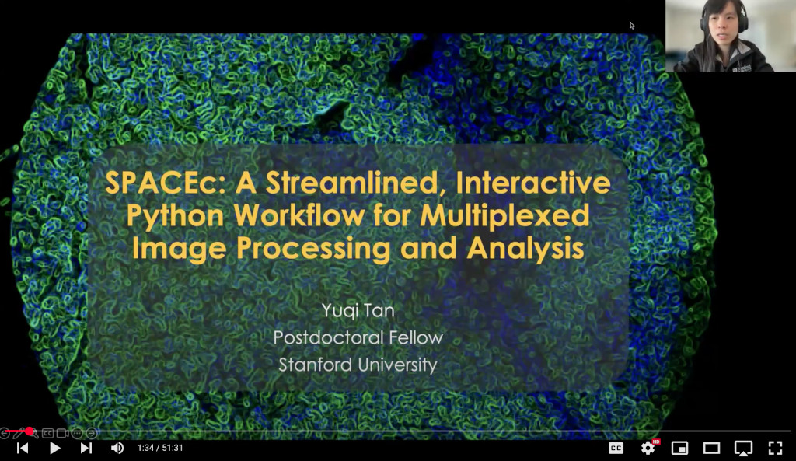

# SPatial Analysis for CodEX data (SPACEc)

[](https://github.com/yuqiyuqitan/SPACEc/stargazers)
[](https://pepy.tech/project/spacec)
[](https://pypi.org/project/spacec/)
[](https://spacec.readthedocs.io/en/latest/?badge=latest)
[](https://github.com/yuqiyuqitan/SPACEc/actions/workflows/ci.yml)
[](https://doi.org/10.1038/s41467-025-65658-3)

# Welcome to SPACEc 2.0
**For the original release described in our [2025 publication](https://doi.org/10.1038/s41467-025-65658-3), please refer to [version 0.1.2](https://github.com/yuqiyuqitan/SPACEc/releases/tag/0.1.2).**

**Multiplexed imaging** technologies offer valuable insights into intricate tissue structures, yet they pose significant computational hurdles. These include cumbersome data handoffs, inefficiencies in processing large images (often ranging from 8 to 40 gigabytes per image), and limited spatial analysis capabilities. We created **SPACEc, an all-in-one, scalable Python platform that advances both analytical capabilities and computational efficiency.** Through careful engineering optimization, it streamlines the entire process from image extraction and cell segmentation to data preprocessing, while introducing novel approaches such as Patch Proximity Analysis for mapping cellular microenvironments to fill in the current analytic gaps. The platform significantly improves the performance of existing tools through parallelization and GPU acceleration, including enhanced cell-cell interaction analysis and simplified deep-learning annotation workflows, while its intuitive user-friendly design makes these advanced spatial analyses accessible to a wider scientific audience.

## General outline of SPACEc analysis



## In-depth introduction to SPACEc

For an in-depth introduction to SPACEc v0.1.2, take a look at this [YouTube video](https://www.youtube.com/watch?v=dmbzcxnABDY).

<a href="https://www.youtube.com/watch?v=dmbzcxnABDY"></a>

## Installation notes

**Note**: We currently support Python `3.10`–`3.12`, and test against `3.12`.
* The **example tonsil data** is available on [dryad](https://doi.org/10.5061/dryad.brv15dvj1)
* The **extensive tutorial** is available [here](https://spacec.readthedocs.io/en/latest/?badge=latest)
* The **original SPACEc version (0.1.2)**, as used in the publication, is available [here](https://github.com/yuqiyuqitan/SPACEc/releases/tag/0.1.2)

**Upgrading from an older SPACEc?** You no longer need to install `graphviz`, `libvips` or `openslide` from conda-forge, apt or brew. `pip install spacec` now pulls all three in as wheels (`pygraphviz`, `pyvips[binary]`, `openslide-bin`), so a plain virtualenv works and conda is optional.

If an older system libvips is still installed and `import spacec` fails with `OSError: cannot load library 'libvips.42'`, rebuild pyvips with the stray copy hidden:

```bash
    PKG_CONFIG_PATH=/nonexistent PKG_CONFIG_LIBDIR=/nonexistent \
        pip install --no-cache-dir --force-reinstall "pyvips[binary]"
```

### Install

<details><summary>Linux</summary>

SPACEc CPU

```bash
    # Create virtual environment (conda create -n spacec python=3.12 works as well)
    python3.12 -m venv spacec-env
    source spacec-env/bin/activate

    # Install spacec
    pip install spacec
```

#### Continue the following steps only if you have GPU(s)

SPACEc GPU

No separate CUDA installation is needed. The PyTorch wheels installed with SPACEc ship their own CUDA runtime and cuDNN.

1. OPTIONAL: For GPU-accelerated clustering via RAPIDS run the following.
    Note that only RTX20XX or better GPUs are supported.
    More information on rapids-singlecell are available here: https://rapids-singlecell.readthedocs.io/en/latest/Installation.html
```bash
    # Check which CUDA your torch was built against:
    python -c "import torch; print(torch.version.cuda)"

    # CUDA 13:
    pip install 'spacec[rapids13]' --extra-index-url=https://pypi.nvidia.com

    # CUDA 12:
    pip install 'spacec[rapids12]' --extra-index-url=https://pypi.nvidia.com
```

2. OPTIONAL: To use STELLAR run the following (or run `sp.tl.install_stellar()`):
```bash
    pip install 'spacec[stellar]'
    pip install torch-scatter torch-sparse -f https://data.pyg.org/whl/torch-2.5.1+cpu.html   # or +cu124 etc.
    pip install git+https://github.com/TKempchen/stellar-py3.12
```

3. OPTIONAL: To use the legacy louvain clustering backend (Python <= `3.11` only) run the following:
```bash
    pip install 'spacec[legacy]'
```

4. Test if SPACEc loads and if your GPU is visible:
    ```bash
    python -c "import spacec as sp; sp.hf.check_for_gpu()"
    ```

</details>


<details><summary>Apple M1/M2/M3/M4</summary>


SPACEc CPU:

```bash
    # Create virtual environment (conda create -n spacec python=3.12 works as well)
    python3.12 -m venv spacec-env
    source spacec-env/bin/activate

    # Install spacec
    pip install spacec
```
Homebrew `vips`, `openslide` and `graphviz` are no longer needed.

SPACEc GPU: Mac GPU support can be limited depending on your PyTorch/Cellpose setup (in some cases we try to use the `MPS` backend if possible but that can be tricky). We recommend to use a Linux system for full GPU acceleration.

SPACEc supports both classic Cellpose (`cyto3`) and Cellpose-SAM (`cpsam`, cellpose>=4) for cell segmentation — see [docs/cellpose_models.md](docs/cellpose_models.md) for how to choose and switch between them.

</details>

<details><summary>Windows</summary>

Although SPACEc can run directly on Windows systems, we highly recommend running it in WSL. If you are unfamiliar with WSL, you can find more information on how to use and install it here: https://learn.microsoft.com/en-us/windows/wsl/install If you decide to use WSL, follow the Linux instructions.

If you plan to continue with the native Windows environment
1. One of the segmentation tools within SPACEc neeeds a C++ compiler. If your environment doesn't have it already, the easiest way is to:
    1. Download the community version of Visual Studio from the official Microsoft website: [https://visualstudio.microsoft.com](https://visualstudio.microsoft.com/). After installing the software on your system, select the following options to install the components needed for C++ development (see screenshots)

        

        

    2. That is the only manual prerequisite. libvips and Graphviz are installed automatically as wheels — you no longer need to download `vips-dev-w64-all` or edit your PATH.

SPACEc CPU:

```bash
    # Create virtual environment (conda create -n spacec python=3.12 works as well)
    py -3.12 -m venv spacec-env
    spacec-env\Scripts\activate

    # Install spacec
    pip install spacec
```

SPACEc GPU:

No separate CUDA installation is needed — the PyTorch wheels ship their own CUDA runtime and cuDNN.

```bash
    # If Pytorch does not find the GPU, reinstall it against a specific CUDA build:
    # pip install torch --index-url https://download.pytorch.org/whl/cu121
```

Test if SPACEc loads and if your GPU is visible if you installed the GPU version.
```python
    import spacec as sp
    sp.hf.check_for_gpu()
```

</details>


<details><summary>Docker</summary>
If you encounter installation issues or prefer a containerized setup, use the SPACEc Docker image. You can build or modify it using the repository's Dockerfiles.

Run these from the repository root:

```bash
# Run CPU version:
docker build -f Docker/spacec_cpu_build.dockerfile -t spacec:cpu .
docker run -p 127.0.0.1:8888:8888 -p 127.0.0.1:5100:5100 spacec:cpu

# If running an amd64 image on apple silicon, use the following command:
docker run --platform linux/amd64 -p 127.0.0.1:8888:8888 -p 127.0.0.1:5100:5100 spacec:cpu

# Or run GPU version:
docker build -f Docker/spacec_gpu_build.dockerfile -t spacec:gpu .
docker run --gpus all -p 127.0.0.1:8888:8888 -p 127.0.0.1:5100:5100 spacec:gpu
```
</details>

## License

SPACEc is distributed under the Stanford Academic Software License for non-commercial academic use only. See [LICENSE.txt](https://github.com/yuqiyuqitan/SPACEc/blob/master/LICENSE.txt) for the full terms. For commercial use, contact Stanford's Office of Technology Licensing.

If you use SPACEc in your research, please cite the SPACEc publication: [doi:10.1038/s41467-025-65658-3](https://doi.org/10.1038/s41467-025-65658-3).

<p align="center">
    <a href="https://clustrmaps.com/site/1c47e" title="ClustrMaps">
        
    </a>
</p>
